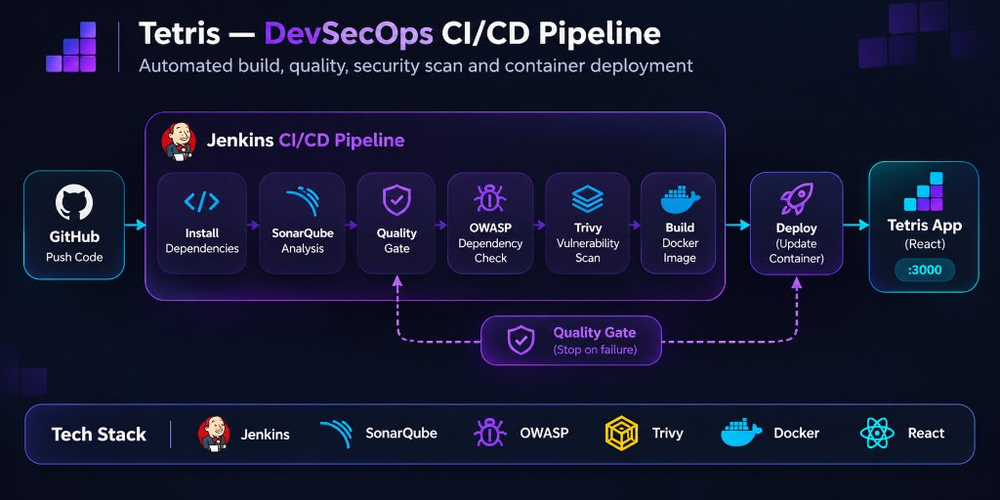

# Tetris — DevSecOps CI/CD Pipeline

A React-based Tetris application with an automated CI/CD pipeline built using Jenkins. The pipeline performs code quality analysis, dependency and vulnerability scanning, builds a Docker image, and deploys the application to a local Docker container.



## Overview

This project demonstrates how application code can move from source control to a running container through an automated Jenkins pipeline, with quality and security checks included before deployment.

## Pipeline Flow

1. **Checkout Source Code** — Jenkins checks out the repository.
2. **Install Dependencies** — Installs Node.js packages using `npm ci`.
3. **SonarQube Analysis** — Analyzes code quality.
4. **Quality Gate** — Checks the SonarQube result and stops the pipeline if the gate fails.
5. **OWASP Dependency-Check** — Scans project dependencies for known vulnerabilities.
6. **Trivy Filesystem Scan** — Scans the project for vulnerable dependencies.
7. **Build Docker Image** — Builds the application image as `tetris-app:local`.
8. **Deploy** — Replaces the `tetris-app-local` container with the newly built image.

## Technology Stack

| Tool | Purpose |
|---|---|
| Jenkins | CI/CD pipeline orchestration |
| Git / GitHub | Source control |
| Node.js / npm | Application dependencies and build |
| SonarQube | Code quality analysis and Quality Gate |
| OWASP Dependency-Check | Dependency vulnerability scanning |
| Trivy | Filesystem vulnerability scanning |
| Docker | Container image build and deployment |
| React | Tetris application |

## Application

After deployment, the application is available locally:

- **Tetris app:** http://localhost:3000
- **Jenkins:** http://localhost:8080
- **SonarQube:** http://localhost:9000

## Prerequisites

- Docker Desktop
- Jenkins configured with the required tools and plugins
- A Node.js tool configured in Jenkins as `nodejs`
- SonarQube configured in Jenkins as `SonarQube`
- SonarScanner configured as `SonarScanner`
- OWASP Dependency-Check configured as `DP-Check`
- Required NVD API credential configured in Jenkins as `nvd-api-key`
- Trivy and Docker CLI available to the Jenkins agent

## Run the Pipeline

1. Configure the Jenkins job to use this repository, with the script path set to `Tetris-V1/Jenkinsfile`.
2. Ensure the Jenkins agent can access the Docker socket.
3. Run **Build Now**.
4. Review the stage results in the Jenkins console output.
5. When the pipeline succeeds, open http://localhost:3000 to verify the deployed app.

The deployment stage replaces the existing `tetris-app-local` container, so the app may be briefly unavailable during deployment.

## Project Structure

```text
.
├── Tetris-V1/
│   ├── Jenkinsfile
│   ├── package.json
│   ├── package-lock.json
│   └── ...
└── docs/
    └── pipeline-flow.png
```

## Notes

- The pipeline deploys locally using Docker; it does not deploy to a cloud environment.
- The Docker image is tagged `tetris-app:local`.
- The Jenkins pipeline is configured to stop at a failed SonarQube Quality Gate.
- Dependency and vulnerability scan findings are reported in the Jenkins build output.

## Future Improvements

- Publish the Docker image to a container registry.
- Add image scanning to the built Docker image.
- Add automated tests and test reporting.
- Add deployment health checks and rollback handling.
- Deploy to a Kubernetes environment.
